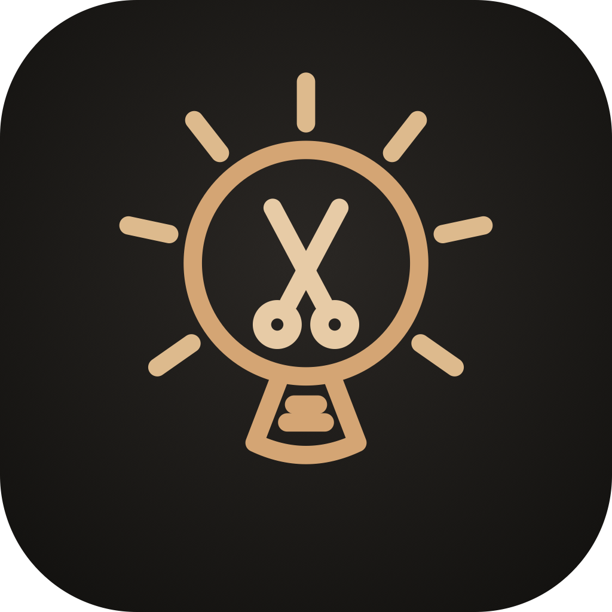

# Umbrella Helper

<p align="center">
  
</p>

A native macOS menu bar app for screen capture/recording and display warmth/brightness (including Film Mode).

## Features

- **SimpleSnip:** area / window / full-screen screenshots, area recording, and OCR text copy
- **Brightness:** warmth + brightness controls, presets, Film Mode (dims external displays), and an optional daytime curve (dim at night, peak at midday) with manual or location-based sunrise/sunset
- **Menu bar:** click for controls; right-click for Settings / Restart / Quit
- **Launch at login** and customizable global hotkeys

## Requirements

- macOS 14 (Sonoma) or later
- Xcode 27 (or Xcode 26 on macOS Tahoe) to build from source

## Install

```bash
git clone https://github.com/wolfromkev/umbrella-helper.git
cd umbrella-helper
chmod +x install.sh
./install.sh
```

Or build, install, and relaunch:

```bash
./build-and-install.sh
```

The script builds a Release app, copies it to `/Applications/Umbrella Helper.app`, and signs it with a stable certificate from your keychain (Apple Development, or `UMBRELLA_SIGN_IDENTITY` if you set one). That keeps Screen Recording, Microphone, and Accessibility granted across rebuilds. The first launch after switching off ad-hoc signing asks for those permissions once.

## First-time setup

1. Launch **Umbrella Helper** from Applications.
2. Open **Settings** (menu bar → right-click → Settings, or `⌘,`).
3. Under **Permissions**, grant **Screen Recording** (and Microphone if you record with mic).

Default shortcuts (all configurable): **⌘⇧S** area snip · **⌘⇧W** window · **⌘⇧A** full screen · **⌘⇧R** record · **⌘⇧T** text OCR · **F1/F2** brightness · **⇧F1/⇧F2** warmth.

## Branding

Open-source assets live in `branding/`:

| File | Use |
|------|-----|
| `logo.svg` | README, docs |
| `icon-1024.png` | App icon master |

## License

MIT — see [LICENSE](LICENSE).
